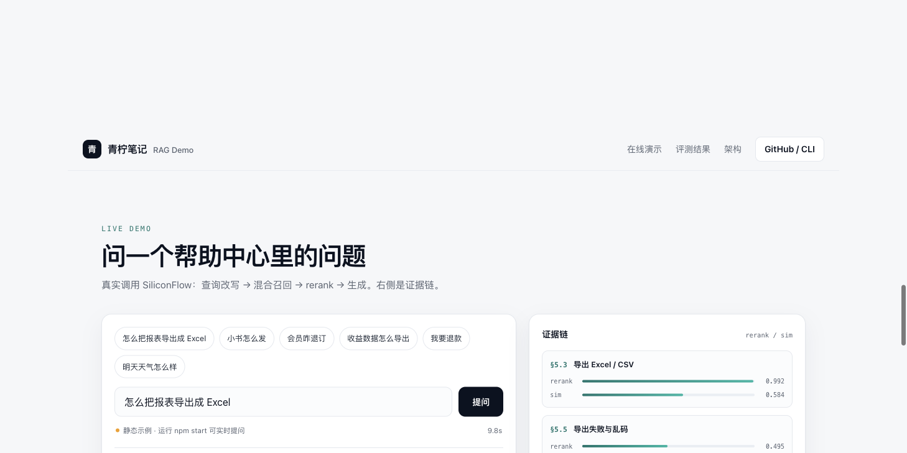

# 青柠笔记 RAG Demo

把帮助中心变成能回答的搜索：**解析 → 切片 → embedding → 索引 → 混合召回 → rerank → prompt → 引用 → 评测**。

一套代码，三种用法：**CLI**、**HTTP API**、**可部署的网站**。

**在线演示：** <https://rag-demo-c2ns.onrender.com>（Render Free，15 分钟无访问会休眠，首次打开约 50 秒）
**静态站点：** <https://samlaying.github.io/rag-demo/>



## 这是什么

一个可运行、可评测的帮助中心 RAG 最小实现：

- 知识库：54 节模拟帮助文档（`data/`），按 `§章.节` 切片，引用粒度天然对齐
- 检索：向量召回 + BM25 分词召回，RRF 融合；原始问题与改写问题**各召回、各 rerank 一次取高分**
- 生成：只依据资料回答，强制 `[n]` 引用；资料没有就说“未找到”；退款/合同/盗号等转人工
- 评测：100 条问题集，含 20 条口语/错别字、10 条应拒答、5 条应转人工
- 可观测：每次回答记录 **6 次 SiliconFlow 调用**（改写 / 2×embedding / 2×rerank / 生成），CLI 和网站都能看到
- 网站：实时 SSE 流式回答 + 证据链 + 调用链面板

模型全部走 [SiliconFlow](https://siliconflow.cn)：

| 环节 | 默认模型 |
|---|---|
| Embedding | `Qwen/Qwen3-VL-Embedding-8B`（4096 维） |
| Rerank | `BAAI/bge-reranker-v2-m3` |
| 查询改写 | `Qwen/Qwen2.5-7B-Instruct` |
| 回答生成 | `deepseek-ai/DeepSeek-V3.2` |

## 快速开始

需要 Node 22+。

```bash
cp .env.example .env
# 编辑 .env，填入 SILICONFLOW_API_KEY

npm run index                 # 建索引（54 chunks，约 20 秒）
npm run demo -- "怎么导出报表"  # 单问题
npm run eval -- 12            # 抽样评测
npm start                     # 网站：http://127.0.0.1:3000
```

没有 Key 也可以看静态网站：`web/demo-data.json` 里有 6 条预生成结果。

## CLI

```bash
npm link                 # 安装为全局命令
rag-demo --index
rag-demo "小书怎么发"
rag-demo "小书怎么发" --trace   # 打印 6 次 SiliconFlow 调用与耗时
rag-demo --eval 100
rag-demo --help
```

模型可用环境变量覆盖：

```bash
CHAT_MODEL=Qwen/Qwen3-8B REWRITE_MODEL=Qwen/Qwen2.5-7B-Instruct rag-demo "..."
```

## HTTP API

`npm start` 后：

| 方法 | 路径 | 说明 |
|---|---|---|
| GET | `/api/health` | 索引状态与模型 |
| POST | `/api/ask` | 一次性返回答案 + 引用 |
| POST | `/api/ask/stream` | SSE：`status` → `meta` → `token` → `done` |

```bash
curl -s http://127.0.0.1:3000/api/ask \
  -H 'Content-Type: application/json' \
  -H "Authorization: Bearer $ACCESS_TOKEN" \
  -d '{"question":"怎么把报表导出成 Excel"}' | jq
```

### 访问口令

设置 `ACCESS_TOKEN` 后：

- `GET /api/health` 保持公开（用于健康检查）
- `POST /api/ask`、`POST /api/ask/stream` 需要 `Authorization: Bearer <token>`
- 网站首次提问会弹出口令输入框，保存在浏览器 localStorage
- 不设置 `ACCESS_TOKEN` 时关闭鉴权，适合本地开发

SSE 事件顺序：

```
event: status  {"stage":"retrieve"}
event: meta    {"rewritten":"...","citations":[...]}
event: token   {"text":"在"}
...
event: done    {"elapsedMs":7392,"trace":[{"endpoint":"/chat/completions","model":"deepseek-ai/DeepSeek-V3.2","ms":6627}]}
```

## 网站

`web/` 是零依赖静态站点：

- 运行时探测 `/api/health`：有后端 → 实时流式；没有 → 自动降级为 `demo-data.json` 静态示例
- 证据链面板展示每个 chunk 的 rerank / sim 分数
- 可直接部署到 GitHub Pages；实时提问需要另跑 `npm start`

## 部署（免费后端）

GitHub Pages 只能跑静态演示；实时问答需要一个 Node 后端。

- 免费方案对比（Render / Koyeb / Cloud Run / Workers / 国内云）：[docs/DEPLOY.md](docs/DEPLOY.md)
- 最快路径：Render → **New Blueprint** → 连接本仓库 → 填 `SILICONFLOW_API_KEY`
- 仓库已带 `Dockerfile`、`render.yaml`，索引预构建在 `data/index.json`，冷启动不需要重新 embedding

## 浏览器 Console

打开 DevTools → Console，每次提问会输出完整链路：

```
▼ [RAG] 怎么把报表导出成 Excel
    question: ...
    mode: live SSE
    [连接] 14ms
    [status] retrieve @ 14ms
    [检索] 1020ms
    检索改写: 如何将报表导出为Excel
    ▦ table  召回证据（section / title / rerank / sim）
    [status] generate @ 1021ms
    [首字] 2265ms
    answer: ...
    ▦ table  6 次 SiliconFlow 调用（endpoint / model / ms / tokens）
    [完成] 8.7s · 6 次调用 · 221 字
```

- `window.__RAG_LAST__` 保存最后一次的 question / rewritten / citations / trace / answer
- URL 加 `?debug=1` 会额外输出每个 token，便于排查流式输出
- 静态模式会输出 `[RAG·静态]` 分组，标明用的是预生成数据

## 评测

12 条抽样（覆盖 howto / troubleshoot / feature / colloquial / version / out_of_scope / handoff）：

| 指标 | 结果 |
|---|---|
| 检索 Recall@12 | 11/11 |
| 重排 Recall@5 | 11/11 |
| 拒答准确率 | 1/1 |
| 转人工准确率 | 1/1 |
| 引用标注率 | 11/12（未标的是拒答题） |

全量复跑：

```bash
npm run eval -- 100
```

## 一个只在批量 > 8 时才出现的坑

SiliconFlow embeddings 接口单批超过 8 条时，返回的 `index` 会每 8 条重置：

```text
传入 16 条，期望 0..15
实际返回 [0,1,2,3,4,5,6,7, 0,1,2,3,4,5,6,7]
```

如果按 `index` 排序，第二批向量会整体错位，表现为“明明有正确文档却召回不到”。单条、8 条以内批量都正常，非常隐蔽。

修复：**不排序，按响应顺序与输入顺序对齐，并校验返回条数**。

```js
if (r.data.length !== batch.length) throw new Error('embedding 返回数量不匹配');
for (const d of r.data) vectors.push(d.embedding);
```

## 目录

```
.
├─ src/rag.mjs          # 检索、生成、评测库
├─ src/server.mjs       # HTTP API + 静态站点
├─ rag-demo.mjs         # CLI
├─ web/                 # 网站（HTML/CSS/JS，无构建）
├─ scripts/             # 生成静态演示数据
├─ data/                # 帮助中心 HTML/PDF、100 条评测 CSV
├─ docs/                # 截图
└─ .github/workflows/   # CI + GitHub Pages
```

## 发布到 GitHub

```bash
cd own/rag-demo
git init -b main
git add .
git commit -m "feat: help-center RAG demo"
gh repo create rag-demo --public --source=. --remote=origin --push
```

网站：仓库 Settings → Pages → Source 选 **GitHub Actions**，推送 `main` 后自动部署 `web/`。

## 数据说明

`data/` 下的产品、价格、客服电话、邮箱均为虚构，仅用于检索与问答评测。评测集故意包含 10 条文档未覆盖的问题——**答出来反而是错的**。

## License

MIT
